# TASK DECOMPOSITION — LAB 4: EXERCISE 2 (1.2, 1.2.1 & 1.2.2)

**Mục tiêu:** Xây dựng Multi-Route SPA với React Router v7, Nested Layout (`<Outlet />`), Active `<NavLink>`, và giao diện Master-Detail sử dụng CSS Grid + Semantic HTML.

## Sơ đồ WBS (Work Breakdown Structure)

```mermaid
flowchart TD
    Root[Exercise 2: Multi-Route SPA & Master-Detail]

    Root --> P1[1. Khởi tạo & Tài liệu]
    Root --> P2[2. Data & Shared Components]
    Root --> P3[3. Pages & Master-Detail]
    Root --> P4[4. Routing & Styling]

    %% 1. Khởi tạo & Tài liệu
    P1 --> P1_1["1.1 docs: TASK_DECOMPOSITION.md, project-rules.md, README.md"]

    %% 2. Data & Shared Components
    P2 --> P2_1["2.1 feat(data): src/data/people.js (ID dạng string)"]
    P2 --> P2_2["2.2 feat(ui): src/components/NotFoundState.jsx (404 Semantic)"]
    P2 --> P2_3["2.3 feat(layout): src/components/Layout.jsx (NavLink + Outlet)"]

    %% 3. Pages & Master-Detail
    P3 --> P3_1["3.1 feat(pages): src/pages/Home.jsx"]
    P3 --> P3_2["3.2 feat(pages): src/pages/About.jsx"]
    P3 --> P3_3["3.3 feat(pages): src/pages/PeopleLayout.jsx (aside + Outlet)"]
    P3 --> P3_4["3.4 feat(pages): src/pages/PersonDetail.jsx (useParams + dl/dt/dd + 404)"]

    %% 4. Routing & Styling
    P4 --> P4_1["4.1 feat(router): src/App.jsx (Routes & Nested Route v7)"]
    P4 --> P4_2["4.2 feat(entry): src/main.jsx (BrowserRouter)"]
    P4 --> P4_3["4.3 style(css): src/index.css (CSS Grid, Responsive, .active)"]
```

## Lộ trình Atomic Commits (1 File / 1 Commit)
1. `docs`: Khởi tạo `TASK_DECOMPOSITION.md`, `project-rules.md`, `README.md`.
2. `feat(data)`: Tạo `src/data/people.js` — Dữ liệu nhân sự chuẩn hóa ID dạng string.
3. `feat(ui)`: Tạo `src/components/NotFoundState.jsx` — Giao diện 404 fallback dùng semantic tags.
4. `feat(layout)`: Tạo `src/components/Layout.jsx` — Shared Layout với `<NavLink>` (có `end` prop) và `<Outlet />`.
5. `feat(pages)`: Tạo `src/pages/Home.jsx` — Trang chủ.
6. `feat(pages)`: Tạo `src/pages/About.jsx` — Trang giới thiệu.
7. `feat(pages)`: Tạo `src/pages/PeopleLayout.jsx` — Master-Detail container (`<aside>` danh sách + `<Outlet />`).
8. `feat(pages)`: Tạo `src/pages/PersonDetail.jsx` — Chi tiết nhân sự (`useParams`, `people.find`, `<dl>/<dt>/<dd>`, 404 fallback).
9. `feat(router)`: Cập nhật `src/App.jsx` — Cấu hình `<Routes>` và Nested `<Route>` theo React Router v7.
10. `feat(entry)`: Cập nhật `src/main.jsx` — Bọc `<BrowserRouter>` từ `react-router`.
11. `style(css)`: Cập nhật `src/index.css` — CSS Grid `minmax(280px, 1fr) 2fr`, responsive và `.active` state (tách riêng commit CSS).